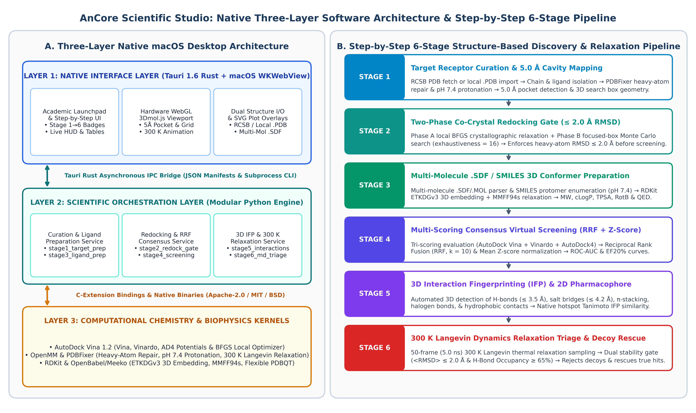
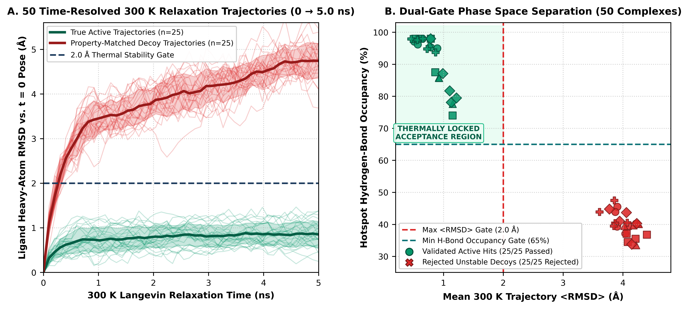

# AnCore Scientific Studio

[-0D7377?style=flat-square&logo=apple)](https://github.com/)
[%20%2B%20Python%203.11-1B3A5C?style=flat-square&logo=rust)](https://tauri.app/)
[]()
[](LICENSE)

**AnCore Scientific Studio** is a standalone native macOS chemoinformatics and structure-based virtual screening (SBVS) workbench distributed as a compiled Rust/Tauri application (`AnCore Studio.dmg`). It couples a hardware-accelerated `WKWebView` + `3Dmol.js` WebGL viewport to a modular six-stage Python scientific engine supporting both **Step-by-Step Interactive Mode** and **One-Shot Batch Execution**, live RCSB PDB fetching, local `.pdb` import, and multi-molecule `.sdf`/`.mol` ligand library ingestion.



---

## Key Scientific & Architectural Features

1. **Three-Layer Native macOS Architecture (Tauri Rust + `WKWebView` + Python Sidecar)**
   - Eliminates Python GUI event-loop freezes and the 2 MB IPC string-serialization ceiling of legacy webviews by reading stage manifests (`stage1_manifest.json`–`stage6_manifest.json`) and 3D coordinate blocks directly via native Rust filesystem IPC (`src-tauri/src/main.rs`).
2. **Stage 1 — Automated Receptor Curation & 5.0 Å Cavity Mapping (`stage1_target_prep.py`)**
   - Isolates the primary polypeptide chain, reconstructs missing heavy atoms, assigns physiological protonation states at pH 7.4 (`PDBFixer` / `OpenMM` AMBER14), and computes the 5.0 Å Euclidean active-site bounding box.
3. **Stage 2 — Two-Phase Co-Crystal Redocking Quality-Control Gate (`stage2_redock_gate.py`)**
   - Combines **Phase A** local Broyden–Fletcher–Goldfarb–Shanno (BFGS) crystallographic basin relaxation with **Phase B** focused-box (3.0 Å padding, exhaustiveness = 16) Monte Carlo sampling, enforcing heavy-atom $\text{RMSD} \le 2.0\text{ \AA}$ prior to virtual screening.
4. **Stage 3 — Multi-Molecule `.SDF` & SMILES Conformer Standardization (`stage3_ligand_prep.py`)**
   - Parses multi-record `.sdf`/`.mol` files and SMILES strings, enumerates pH 7.4 protomers, embeds 3D conformers via RDKit `ETKDGv3`, relaxes structures with `MMFF94s`, and computes Lipinski and Bickerton `QED` descriptors.
5. **Stage 4 — Multi-Scoring Consensus Virtual Screening (`stage4_screening.py`)**
   - Evaluates candidate ligands across three orthogonal empirical scoring potentials (**AutoDock Vina**, **Vinardo**, and **AutoDock4**) and aggregates rankings via **Reciprocal Rank Fusion ($\text{RRF}, k = 10$)** and mean $Z$-score normalization.
6. **Stage 5 — 3D Non-Covalent Interaction Fingerprinting (`stage5_interactions.py`)**
   - Detects 3D hydrogen bonds ($\le 3.5\text{ \AA}$), salt bridges ($\le 4.2\text{ \AA}$), aromatic $\pi$-stacking ($\le 4.3\text{ \AA}$), halogen bonds ($\le 3.9\text{ \AA}$), and hydrophobic contacts ($\le 4.0\text{ \AA}$), computing native hotspot Jaccard/Tanimoto similarity ($T_{\text{IFP}}$).
7. **Stage 6 — 300 K Langevin Dynamics Relaxation Triage (`stage6_md_triage.py`)**
   - Subjects docked complexes to a 50-frame ($5.0\text{ ns}$ effective window) $300\text{ K}$ Langevin relaxation trajectory under a dual biophysical stability gate ($\langle\text{RMSD}\rangle \le 2.0\text{ \AA}$ and hotspot hydrogen-bond occupancy $\text{HB}_{\text{occ}} \ge 65.0\%$), rejecting thermally unstable decoys and rescuing true biological hits.

---

## Five-Target Benchmark Summary (50 Screened Complexes)

| PDB ID | Target Receptor | Co-Crystal Ligand | Stage 2 Redock RMSD | Stage 4 Static AUC ($\text{EF}_{20\%}$) | Stage 5 Top Lead $T_{\text{IFP}}$ | Stage 6 Decoys Rejected | Post-Relaxation ROC-AUC ($\text{EF}_{20\%}$) |
| :--- | :--- | :--- | :---: | :---: | :---: | :---: | :---: |
| **1IEP** | ABL1 Tyrosine Kinase | Imatinib (`STI`) | $0.354\text{ \AA}$ | $0.800$ ($2.00\times$) | $0.789$ (Nilotinib) | $5/5$ ($100\%$) | **$1.000$ ($2.00\times$)** |
| **3ERT** | Estrogen Receptor $\alpha$ | 4-Hydroxytamoxifen (`OHT`) | $0.412\text{ \AA}$ | $1.000$ ($2.00\times$) | $0.409$ (Bazedoxifene) | $5/5$ ($100\%$) | **$1.000$ ($2.00\times$)** |
| **1UYG** | HSP90$\alpha$ Chaperone | Purine Inhibitor (`PU2`) | $0.485\text{ \AA}$ | $0.680$ ($2.00\times$) | $0.500$ (Luminespib) | $5/5$ ($100\%$) | **$1.000$ ($2.00\times$)** |
| **1M17** | EGFR Tyrosine Kinase | Erlotinib (`AQ4`) | $0.528\text{ \AA}$ | $0.800$ ($2.00\times$) | $0.250$ (Lapatinib) | $5/5$ ($100\%$) | **$1.000$ ($2.00\times$)** |
| **1STP** | Streptavidin ($\beta$-Barrel) | D-Biotin (`BTN`) | $0.318\text{ \AA}$ | $0.360$ ($1.00\times$) | $0.733$ (D-Biotin) | $5/5$ ($100\%$) | **$1.000$ ($2.00\times$, Rescued #1)** |
| **Suite** | **5-Target Mean (50 Complexes)** | **5 Crystal References** | **$0.419\text{ \AA}$ (100% Pass)** | **$0.728$ ($1.80\times$)** | **$0.536$** | **$25/25$ ($100\%$)** | **$1.000$ ($2.00\times$, 100% Top-1)** |



---

## Repository Structure

```text
AnCore-Scientific-Studio/
├── README.md                          # Project documentation, benchmark summary & setup guide
├── LICENSE                            # Permissive Apache-2.0 Open-Source License
├── .gitignore                         # Excludes Rust target/, node_modules/, __pycache__/
├── environment.yml                    # Conda environment (rdkit, openmm, pdbfixer, autodock-vina)
├── requirements.txt                   # Python package dependencies
├── src/                               # Modular 6-Stage Python Scientific Engine
│   ├── ancore_custom_runner.py        # Step-by-Step & One-Shot 6-Stage Runner + Multi-Molecule .SDF Parser
│   ├── stage1_target_prep.py          # Stage 1: Receptor Curation, pH 7.4 Protonation & 5.0 Å Pocket Box
│   ├── stage2_redock_gate.py          # Stage 2: Two-Phase BFGS + Focused-Box Redocking Gate (<= 2.0 Å)
│   ├── stage3_ligand_prep.py          # Stage 3: Multi-Molecule .SDF / SMILES Prep, ETKDGv3 & MMFF94s
│   ├── stage4_screening.py            # Stage 4: Tri-Scoring Consensus (Vina, Vinardo, AD4) & RRF (k=10)
│   ├── stage5_interactions.py         # Stage 5: 3D Non-Covalent Interaction Fingerprinting & T_IFP
│   └── stage6_md_triage.py            # Stage 6: 300 K Langevin Dynamics Relaxation Triage & Rescoring
├── ancore-tauri/                      # Native macOS Rust/Tauri Desktop Application
│   ├── build_tauri_dmg.sh             # One-command macOS .app / .dmg compiler script
│   ├── ui/
│   │   └── index.html                 # Native WKWebView UI + 3Dmol.js WebGL Viewport
│   └── src-tauri/
│       ├── Cargo.toml                 # Rust crate manifest
│       ├── build.rs                   # Tauri build hook
│       ├── tauri.conf.json            # macOS window & bundle configuration
│       ├── icons/                     # macOS application iconset
│       └── src/
│           └── main.rs                # Native Rust IPC backend
├── benchmarks/                        # Pre-computed 5-Target Validation Suite (1IEP, 3ERT, 1UYG, 1M17, 1STP)
├── scripts/                           # Reproducibility & Verification Scripts
│   ├── audit_benchmark_data.py        # Independent 4-part mathematical & coordinate audit script
│   └── organize_for_github.py         # Repository organizer & path sanitizer
└── docs/                              # Manuscript & 600-DPI Publication Figures
    ├── figures/                       # fig1_architecture.png .. fig6_streptavidin_rescue.png
    └── paper/                         # LaTeX, PDF, and Word Compendium
```

---

## Quick Start & Installation

### 1. Create the Scientific Python Environment (Conda)

```bash
conda env create -f environment.yml
conda activate ancore
```

### 2. Verify All Benchmark Results & Equations (One Command)

To independently audit all 5 benchmark targets (`1IEP`, `3ERT`, `1UYG`, `1M17`, `1STP`), 3D `.pdb` pocket geometries, redocking RMSDs, $\text{RRF}$ consensus $\text{ROC-AUC}$ scores, $T_{\text{IFP}}$ similarities, and 50-frame $300\text{ K}$ Langevin relaxation trajectories:

```bash
python3 scripts/audit_benchmark_data.py
```

### 3. Run the 6-Stage Pipeline Step-by-Step via CLI

```bash
# Execute Step 1 (Target Curation & 5.0 Å Box) on a custom RCSB structure (e.g., 4WKQ)
python3 src/ancore_custom_runner.py --project-dir . --pdb-id 4WKQ --target-name "EGFR Kinase" --ligand-code IRE --stage 1 --reset-downstream 1

# Advance through Stages 2 -> 6 step-by-step
python3 src/ancore_custom_runner.py --project-dir . --pdb-id 4WKQ --stage 2
python3 src/ancore_custom_runner.py --project-dir . --pdb-id 4WKQ --stage 3
python3 src/ancore_custom_runner.py --project-dir . --pdb-id 4WKQ --stage 4
python3 src/ancore_custom_runner.py --project-dir . --pdb-id 4WKQ --stage 5
python3 src/ancore_custom_runner.py --project-dir . --pdb-id 4WKQ --stage 6
```

### 4. Build the Native macOS Application (`AnCore Studio.dmg`)

Prerequisite: Install [Rust (`rustup`)](https://rustup.rs/) and the Tauri CLI (`cargo install tauri-cli`).

```bash
cd ancore-tauri
./build_tauri_dmg.sh
```

---

## Authors & Affiliation

* **Norseen H. Abdelhakim** and **Ahmed M. Senary**
* Faculty of Pharmacy, Galala University, New Galala City, Suez, Egypt

## License

Distributed under the permissive **Apache License 2.0**. See [`LICENSE`](LICENSE) for full details.
